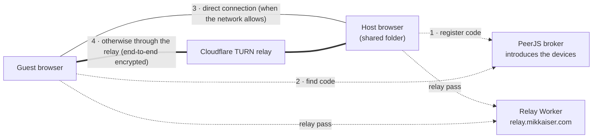

# LAN Drop

Share a folder from your computer with anyone who has the link, right from the browser. No install, no account, and the files never get stored on a server.

**Live:** https://mikkaiser.github.io/lan-drop/

## How it works in 50 seconds

[](https://mikkaiser.github.io/lan-drop/how-lan-drop-works.mp4)

*Click the image to play the video.* It's also on the site: **How LAN Drop works**, in the footer.

## Offline: LAN Drop Local

For networks with no internet (a router on its own, a phone hotspot without data, or two computers joined by an Ethernet cable) there's **LAN Drop Local**, a small program the host runs. Download it from the site's footer (**Download LAN Drop Local**) or the [releases page](https://github.com/Mikkaiser/lan-drop/releases/latest).

- **Host:** run the program, pick the folder to share (it remembers it), and LAN Drop Local opens in the browser with the address and a QR code. **Change folder** picks another one.
- **Everyone else:** open that address, e.g. `http://192.168.1.20:8080`, in any browser on any device. No account, no internet, and no Chrome/Edge requirement.
- **How files travel:** over plain HTTP straight between the guest's browser and the host's computer, with no broker or relay. That's full local-network speed.
- **Who's connected:** the host sees each person's device and real local IP.
- **The look:** the same Broadside look as the site, with live file list updates. It follows network changes, such as plugging in a cable.

Source: [`local/`](local/). `server.js` is the program, with no dependencies beyond Node, and `public/` is its page. `node local/server.js` runs it from source; `node local/build.mjs` builds a single-file program for the current platform. Pushing a `local-v*` tag runs [`.github/workflows/local-release.yml`](.github/workflows/local-release.yml), which builds Windows, Mac (Apple Silicon and Intel) and Linux versions and publishes them as a release. Options: `--folder <path>`, `--port <n>`, `--choose`, `--no-open`.

The programs aren't code-signed yet. On Windows, SmartScreen asks for **More info → Run anyway**; on a Mac, **right-click → Open** the first time.

## Using it

- **Host:** open the site in Chrome or Edge on a computer, click **Choose shared folder…** and allow editing. Share the 6-letter code, the link or the QR code. Keep the tab open while sharing.
- **Everyone else:** open the link, scan the QR code or type the code, on any device and in any modern browser. Download files from the host's folder, or drop files on the page to upload them straight into it.
- **Who's connected:** the host's top right shows how many people are connected, their device (e.g. "iPhone · Safari") and their IP address, marked "via relay" when their connection goes through the relay.
- **Coming back:** reopen the site, or your own share link, in the same browser and click **Resume sharing**. The code stays the same, so links people already have keep working. If Chrome remembers the folder permission ("Allow on every visit"), sharing resumes on its own.
- **New code** disconnects everyone and makes a fresh code. **Stop sharing** ends the share.

| | Host a folder | Join a share |
|---|---|---|
| Chrome, Edge, Brave, Opera, Vivaldi, Arc on a computer | ✅ | ✅ |
| Firefox, Safari | ❌ (no File System Access API) | ✅ |
| Phones and tablets | ❌ | ✅ |

## How it works



1. **The folder stays on the host's computer.** The host's page reads and writes it through the browser's File System Access API. Guests' uploads are written straight into it, and files added in Explorer or Finder show up for everyone within about 2 seconds.
2. **The broker only introduces devices.** The free public [PeerJS](https://peerjs.com) broker matches a guest to the host's code and passes along the connection setup. No file data goes through it.
3. **WebRTC tries a direct connection first.** On networks that allow it, devices talk to each other directly.
4. **Otherwise the data goes through a relay.** Many staff and guest Wi-Fi networks block devices from reaching each other. Then the data goes through Cloudflare's TURN relay. Transfers are encrypted from one browser to the other (DTLS), so the relay only passes along data it can't read.

The share code stays the same when the host reloads or switches networks, and guests reconnect on their own.

## Speed

One WebRTC connection only keeps a limited amount of data in flight, which caps its speed on long or lossy routes such as the relay. So:

- **4 connections per guest.** Each guest opens one control connection plus three extra "lanes" to the host. The host still counts the guest once.
- **4 MB segments.** Each file is split into 4 MB segments spread across the lanes, with two segments moving on each lane at a time. Both sides write every segment at its exact position in the file.
- **Recovery.** If a lane drops, its unfinished segments are sent again on the others.
- **Compatibility.** Pages that are still running an older cached version fall back to a single connection, in both directions.
- **Visible speed.** Every transfer shows its average speed, e.g. "45% · 2.3 MB/s".

Limits that no app can get around: across different networks, speed can't exceed the sender's upload or the receiver's download. When two devices on the same network have to use the relay, every file goes out to the internet and back in, so it can't reach local network speed.

### Direct connections on the same network

WebRTC always tries the local network first. But Chrome and Edge hide each computer's local address behind a random `.local` name, and many networks can't resolve those names, so devices on the same network often fall back to the relay. LAN Drop helps with that:

- **Routes on screen:** the host's list labels each person "direct · same network", "direct · internet" or "via relay", and each guest sees their own route in the status line.
- **Hint:** when someone with the host's public IP (so almost certainly on the same network) is going through the relay, the host sees a hint and a one-time how-to: set **Anonymize local IPs exposed by WebRTC** to **Disabled** in `chrome://flags` (or `edge://flags`), or use the `WebRtcLocalIpsAllowedUrls` policy for this site only. Only the host's computer needs it.
- **On/off line:** the host panel shows whether this browser currently hides its local address.

Networks that isolate devices from each other (some staff and guest Wi-Fi) can't be helped; there the relay is the only route.

### Who's connected

Guests send a heartbeat every 10 s and a goodbye when their page closes. The host also watches each connection, so someone who closes the tab, loses Wi-Fi or puts their laptop to sleep drops off the list within seconds. Pages that send no heartbeat (older cached versions) are removed when their connection closes.

## The relay (`worker/`)

A browser has to hold relay credentials itself, because the browser connects to the relay directly. `worker/` is a Cloudflare Worker that gives each visitor short-lived credentials (valid for 3 hours), so the long-lived TURN key never appears in the public page.

- **Bot check:** the Worker only issues credentials to requests carrying a valid [Cloudflare Turnstile](https://developers.cloudflare.com/turnstile/) token from this page. Real visitors normally see nothing; a checkbox appears only if Turnstile insists. Scripts that fake the `Origin` header are refused. Embedded or automated browsers may fail the check; they then only get direct connections.
- **Spending guard:** before issuing credentials, the Worker reads the account's TURN usage (ingress + egress, last 31 days). It stops at `RELAY_LIMIT_GB` (900 GB), below Cloudflare's free 1,000 GB a month. If it can't read usage, it refuses (fail closed).
- **Three addresses, all tried at once:** `relay.mikkaiser.com` (custom domain), `lan-drop-relay.pages.dev` (`relay-proxy/`, a Pages project that only forwards to the Worker through a service binding) and `lan-drop-turn.mikkaiser-ribeiro.workers.dev`. Some networks block the Cloudflare addresses the last two resolve to; the custom domain gets addresses they can reach.
- **Public IP:** the Worker also tells each browser its public IP, which the host's list shows. Browsers hide local network IPs from web pages.

| Setting | Kind | What it is |
|---|---|---|
| `TURN_KEY_ID`, `TURN_KEY_API_TOKEN` | Secret | Cloudflare **Realtime → TURN Server** key |
| `ANALYTICS_API_TOKEN` | Secret | API token with **Account Analytics: Read**, for the spending guard |
| `TURNSTILE_SECRET` | Secret | Turnstile widget's Secret Key. Delete it to turn the bot check off. |
| `ALLOWED_ORIGINS`, `ACCOUNT_ID`, `RELAY_LIMIT_GB` | Var in `worker/wrangler.toml` | Allowed sites, account to read usage from, spending limit |

Secrets live only in Cloudflare; none are in this repository.

## Project layout

| Path | What it is |
|---|---|
| `index.html` | The page's markup |
| `css/site.css` | All the styling, in sections |
| `js/main.js` | Entry point: join a share, resume hosting, or show the start screen |
| `js/host.js` | Hosting: the folder, one `GuestSession` per connected guest, the people list |
| `js/guest.js` | Joining: connecting, lanes, downloads and uploads |
| `js/protocol.js` | The messages and binary frames between guest and host, sending, the lane scheduler |
| `js/relay.js` | Relay passes from the Worker, the Turnstile bot check, hourly refresh |
| `js/routes.js` | Which route a connection took (same network, internet, relay) |
| `js/files-view.js` | The shared file list, progress rows, drag and drop |
| `js/modals.js` | Popups, and the footer's video and download panels |
| `js/config.js` | Every setting and limit in one place |
| `js/util.js` | Small helpers: formatting, file names, saved settings |
| `local/` | LAN Drop Local: `server.js` (one file, for the single-executable build), its page in `public/`, `build.mjs` |
| `how-lan-drop-works.mp4`, `.jpg` | The 50 s explainer video (1080p, 1.8 MB) and its poster; the footer link loads the video only when opened |
| `fonts/` | Barlow and IBM Plex Mono, self-hosted |
| `favicon.svg`, `favicon-*.png` | Site icon: an arrow dropping into a tray |
| `worker/` | Relay Worker: credentials, bot check, spending guard |
| `relay-proxy/` | Pages forwarder giving the Worker a second address |

## Look

The site and the video share one visual identity, "Broadside": an ink-black ground (`#111111`), cream text (`#F0ECE5`) and fire-orange (`#E85D26`) as the only accent. Headings are heavy lowercase Barlow; labels and buttons are uppercase IBM Plex Mono. Everything is flat and square, with 1 px hairlines and no shadows or rounded corners.

The video was made with [HyperFrames](https://hyperframes.heygen.com) in a separate project (`~/projects/lan-drop-video` in WSL), with a local Kokoro voice and Pixabay sound effects. Only the finished MP4 and its poster live in this repository.

## Deploying

- **Site:** GitHub Pages serves `main`, so pushing is deploying.
- **Worker:** `npx wrangler deploy` in `worker/`. Set secrets with `npx wrangler secret put NAME`.
- **Forwarder:** `npx wrangler pages deploy --branch main` in `relay-proxy/`.
- **Settings in the page:** in `js/config.js`, `RELAY_URLS` lists the Worker's addresses and `TURNSTILE_SITE_KEY` holds the Turnstile Site Key (public by design). The site's origin must be in `ALLOWED_ORIGINS`.

## Run locally

Any static file server works, for example:

```
python -m http.server 5173
```

Turnstile only issues tokens on the widget's hostname, so locally the page asks for relay credentials without a token.

## Notes

- Anyone with the code can see, upload and delete files in the shared folder.
- Only files directly inside the shared folder are shared, not subfolders.
- The host must keep the tab open while sharing.
